# Architecture

OLCF has three layers: **clients**, a **control plane** and a **fleet of worker agents** that run Spark and Python next to the data. A **data plane** of ordinary storage (local disk, S3, MinIO, ADLS Gen2, OneLake) sits underneath and is read and written directly by the workers.

## The picture

```mermaid
flowchart TB
    subgraph clients [Clients]
        UI[Web console<br/>served from the package]
        CLI[olcf CLI]
        SDK[Python SDK]
        FAB[Fabric notebook<br/>olcf_fabric]
        AGENT[AI agent<br/>MCP client]
        EXT[Prometheus, SIEM,<br/>webhook receivers]
    end
    subgraph cp [Control plane - FastAPI, one process or N behind a balancer]
        direction TB
        GW[HTTP layer: correlation id, security headers,<br/>authentication, error envelope]
        subgraph mods [Feature modules mounted under /v1]
            ID[identity, RBAC, tokens,<br/>audit, secrets, PKI]
            WS[workspaces, items,<br/>connections]
            DATA[storage, catalog, SQL,<br/>reports, sample]
            NB[notebooks, environments,<br/>Spark jobs, Git sync]
            ORCH[pipelines, triggers,<br/>webhooks, alerts]
            FA[Fabric adapter]
            INTEL[Intelligence:<br/>asset graph, lineage,<br/>discovery, governance]
            MC[MCP endpoint /mcp]
            OBS[observability]
            OPS[backup, updates,<br/>diagnostics, retention]
        end
        COMP[Compute: worker hub, scheduler, job and session services,<br/>provider manager, runtime catalog]
        LEAD[Leader lease<br/>singleton loops]
        DB[(Metadata database<br/>SQLite or PostgreSQL)]
        FS[(Data directory: keys, CA,<br/>logs, artifacts, backups)]
    end
    subgraph fleet [Worker fleet]
        W1[Worker agent<br/>runtimes A and B side by side]
        W2[Worker agent<br/>runtime A]
        W3[Worker agent<br/>runtime B]
    end
    subgraph ext [Other compute providers]
        K8S[Kubernetes]
        LIVY[External Spark,<br/>Fabric Livy]
    end
    subgraph data [Data plane]
        ST[(local, S3, MinIO, ADLS Gen2, OneLake<br/>Delta, Iceberg, Parquet)]
    end
    UI & CLI & SDK --> GW
    FAB -->|signed capsule, HTTPS| GW
    AGENT --> GW
    GW --> mods
    mods --> DB
    mods --> COMP
    COMP --> DB
    LEAD --> COMP
    LEAD --> ORCH
    OBS --> EXT
    ORCH --> EXT
    COMP -. "dataset.* events<br/>(best effort)" .-> INTEL
    INTEL -. "scans: metadata,<br/>definitions" .-> ST
    INTEL -.->|"Fabric REST, OneLake,<br/>Power BI admin"| EXTMS[Microsoft Fabric and<br/>Power BI tenant]
    COMP <-->|outbound WebSocket, optional mTLS| W1 & W2 & W3
    COMP -.->|pods, Livy sessions| K8S & LIVY
    W1 & W2 & W3 -->|direct, with credentials<br/>resolved by the control plane| ST
    DATA -.->|control-plane reads:<br/>DuckDB, delta-rs| ST
```



The same picture as text:

```
CLIENTS       Web console | olcf CLI | Python SDK | Fabric notebook (olcf_fabric) | AI agent (MCP)
                  \            |          |              /                          /
                   +-----------+----------+-------------+--------------------------+
                                          | HTTPS: REST /v1, /mcp, capsule submit
CONTROL PLANE  +--------------------------v--------------------------------------------+
               | HTTP layer (correlation id, security headers, authn, error envelope)     |
               | 14 feature modules: identity | workspaces | storage | catalog | SQL     |
               |   compute | notebooks | pipelines | Fabric | Intelligence | MCP |      |
               |   observability | ops | sample                                       |
               | worker hub | scheduler | job/session services | runtime catalog         |
               | leader lease: scheduler, triggers, alerts, retention run on one node    |
               +-----------+---------------------------------+---------------------------+
                           | SQLAlchemy Core                 | outbound WebSocket
                 SQLite | PostgreSQL                         | (agents dial in)
WORKER FLEET   +------------------------------+-----------+--+-------------------------+
               | agent A: runtimes A, B       | agent B: A | agent C: B               |
               +--------------+---------------+------+-----+------------+--------------+
                              | Spark driver and executors read/write directly         |
DATA PLANE     +--------------v---------------------------------------v----------------+
               | local | S3 / MinIO | ADLS Gen2 | OneLake      (Delta, Iceberg, Parquet) |
               +-------------------------------------------------------------------------+
```

## Control plane

The control plane is one Python application, `olcf.api.app:create_app`, started by `olcf serve` (uvicorn). At start-up it builds an `AppContext` (settings, database, secrets, audit log, event bus, health registry, token service, authorizer, PKI, leader elector) and installs the **feature modules** listed in `olcf/api/modules.py` in this order:

| # | Module (package) | Owns |
|---|---|---|
| 1 | `olcf.api.core` | identity, workspaces, items, connections, secrets, audit, events, operations, admin and health endpoints |
| 2 | `olcf.security.federation` | OIDC and Microsoft Entra login, external bearer validation, LDAP bridge, identity-provider API |
| 3 | `olcf.storage` | storage providers (local, S3, ADLS Gen2, OneLake), lakehouses, files and tables, Delta and Iceberg inspection and maintenance, the Delta interop policy |
| 4 | `olcf.catalog` | logical catalog, schema snapshots, lineage edges, search |
| 5 | `olcf.sql` | SQL engines (DuckDB, Spark), the read/write guard, history, saved queries, reports and dashboards |
| 6 | `olcf.compute` | worker hub and enrolment, pools, queues, providers, runtimes, jobs, sessions, Spark application UI proxy, topology |
| 7 | `olcf.notebooks` | notebook formats and parameters, environments and locks, Spark job definitions, variable sets, Git sync, deployment promotion |
| 8 | `olcf.pipelines` | pipeline engine, activities, triggers, outbound webhooks, alert rules |
| 9 | `olcf.fabric` | Fabric adapter: capsule verification, analyzer, notebook acquisition, OneLake and Entra helpers, diagnostics |
| 10 | `olcf.intelligence` | OLCF Intelligence: the asset graph, lineage analyzers, discovery connectors and scans, sampling policies, governance. Optional and failure-isolated; see [OLCF Intelligence](intelligence.md) |
| 11 | `olcf.mcp` | MCP endpoint at `/mcp` and the agent helpers (including the read-only `intel_*` and `governance_*` tools) |
| 12 | `olcf.observability` | metrics registry, Prometheus and OTLP export, API metrics middleware, alert evaluation |
| 13 | `olcf.ops` | backup and restore, signed updates, diagnostics, support bundle, retention |
| 14 | `olcf.sample` | sample workspace installer (it also gives the sample its Intelligence content) |

Each module exposes `install(ctx)`, registers services (`ctx.register_service`), health checks, item hooks and connection testers, and returns routers that are mounted under `/v1` (public routers such as `/mcp` and the inbound webhooks are mounted at the root or under `/v1/hooks`). A module that is missing is skipped with a warning, so a partial checkout still boots; a release build must contain all fourteen. Modules talk to each other only through the registered service names (`ctx.service("jobs")`, `ctx.maybe_service("fabric")` and so on), which is how the Fabric code stays out of the generic core. Intelligence goes one step further: nothing in the platform imports it, and the platform reaches it only through published events (`dataset.*`, `pipeline.run.*`) that it consumes from a durable inbox, so it can be disabled or broken without affecting jobs, SQL or pipelines. The dependency rules and the data flow are in [OLCF Intelligence](intelligence.md#failure-isolation-and-the-no-circular-dependency-rule).

The web console is a set of static files under `olcf/web/static`, mounted at `/` when `server.serve_ui` is true.

### Cross-cutting behaviour

* **Authentication and authorisation.** Every request is authenticated (platform JWT, personal access token, or a validated external OIDC/Entra token), and every handler calls `principal.require("<permission>", workspace_id=...)`. See the [security model](security-model.md).
* **Rate limits.** An in-process sliding-window limiter protects the endpoints an unauthenticated caller can reach or that are expensive to abuse: login (per address and per user name), OIDC and LDAP login, worker enrolment, the inbound pipeline webhooks and the MCP endpoint. The limiter is per process, so with several control-plane nodes the effective limit is the limit times the number of nodes.
* **Error envelope.** Every error is `{"error": {"code", "message", "details", "remediation", "correlation_id"}}` ([error reference](../reference/errors.md)).
* **Conventions.** Lists are `{"items": [...], "next_cursor": ...}`; updates use `ETag` and `If-Match`; long-running mutations accept an `Idempotency-Key` and return an operation or job.
* **Events and audit.** State changes publish events (`events` table, SSE stream, webhooks) and security-relevant actions are written to the hash-chained audit log ([events reference](../reference/events.md)). In-process subscribers of the event bus (the Intelligence inbox writer is one) are called on a delivery lane of their own, one thread per subscriber, in publish order; a publisher waits for the subscribers of its event for at most 0.5 seconds in total, so a slow, hung or raising subscriber cannot hold a job state change, a SQL statement or a pipeline run for longer. A subscriber that is stuck has its events queued (bounded at 10,000, the oldest dropped and counted); the persisted event, the SSE stream and webhooks are not affected. Do not rely on a subscriber having *finished* when `publish` returns: fast ones have, within the budget.

### State and the data directory

All durable state is in the metadata database (SQLAlchemy Core, one migration stream per package, tables work on SQLite and PostgreSQL). SQLite runs in WAL mode and is for a single control-plane process. PostgreSQL is required for more than one process. Files that do not belong in a database live in the data directory (default `~/.olcf`): `secrets/` (master key, JWT signing key), `pki/` (the built-in CA), `logs/`, `jobs/` (job logs and, below each job, its artifacts), `backups/`, `runtimes/`, `storage/` (default local lakehouses) and `workers/` (state of the embedded worker).

### Singletons and high availability

Several loops must run on exactly one node: the scheduler, the pipeline dispatcher, trigger evaluation, alert evaluation, retention and metric sampling. They run only on the node that holds the **leader lease**, a row in the database with a 15 second time to live renewed every third of that. A node that cannot renew stops acting as leader before another can take over. Everything else (API requests, agent callbacks, WebSocket relays) can be served by any node, which is why `olcf serve --workers N` with N > 1, or several machines behind a load balancer, needs PostgreSQL. Details and measured take-over times: [high availability](../guides/high-availability.md).

## Worker agents

A **worker agent** (`olcf-worker`, `olcf.worker`) runs on every machine that contributes compute. It enrols once with a single-use token, receives a worker token (and a client certificate if mTLS is on), then keeps an **outbound** WebSocket open to `/v1/workers/ws`. It reports its inventory and health, accepts commands (run a job, start a kernel, start or stop Spark daemons, install a runtime, probe the network) and streams logs and state back. It runs jobs in their own process group, keeps secrets only in a 0600 spec file that is shredded at job end, and re-adopts running jobs and Spark daemons after its own restart. The wire protocol is described in [components and data flow](components-and-data-flow.md#worker-protocol).

On a single machine, the control plane starts an **embedded worker** as a child process and enrols it automatically (`compute.embedded_worker`, on by default). The embedded worker uses the same protocol as a remote one; the only difference is that its jobs do not survive a restart of the control plane because the agent is stopped with it.

## Spark runtimes and providers

A **runtime** is an immutable, signed, side-by-side installation under a worker's state directory: a Python virtual environment with PySpark and hash-pinned wheels, resolved and verified jars, a manifest, a lock file and a `VERIFIED` marker. A **provider** decides how a Spark application is started: `standalone` (Spark Standalone masters and workers on the fleet, one cluster per runtime), `local` (driver and executors in one process on one node), `external` (an existing Spark master or a Livy endpoint), `kubernetes` (driver pods) and `fabric` (the Fabric Livy API). With the default `auto` the scheduler picks `standalone` when some node can host a master, a worker and a driver within its reservations, and falls back to `local` otherwise. See [compute model](compute-model.md).

## Deployment shapes

| Shape | Components | Metadata | Typical use |
|---|---|---|---|
| All in one | one `olcf serve` process plus the embedded worker | SQLite | laptop, workstation, small team, a single VM, the `allinone` Compose profile |
| On-premises cluster | one control plane (or several behind a balancer) plus an `olcf-worker` on each machine | PostgreSQL for more than one control-plane process; SQLite is possible for one | a few to dozens of machines; Spark Standalone spans machines |
| Kubernetes | Helm chart: control-plane Deployment, PostgreSQL, worker StatefulSet, NetworkPolicies; optional Kubernetes compute provider | PostgreSQL | a cluster you already run |
| Fabric extension | any of the above, reachable by HTTPS from Fabric notebooks | any | run Fabric notebooks on your own Spark; OneLake stays the data plane |
| Air-gapped | any of the above with an offline install bundle, a wheelhouse and offline runtime bundles | any | no internet access |

Deployment procedures: [getting started](../getting-started/README.md), [`deploy/README.md`](../../deploy/README.md), [Kubernetes](../operations/kubernetes.md), [production checklist](../operations/production-checklist.md).

## Extension points

Three plug-in interfaces are public and loaded from Python entry points:

| Entry-point group | Implements | Purpose |
|---|---|---|
| `olcf.storage_providers` | a storage provider class | add a storage back end next to local, S3, ADLS Gen2 and OneLake |
| `olcf.compute_providers` | a class implementing `ComputeProvider` (`discover`, `submit`, `status`, `logs`, `cancel`, `scale`, `ui`, `reconcile`) | add a way to run Spark applications |
| `olcf.pipeline_activities` | an `Activity` subclass (`type`, `schema`, `start`, `poll`, `cancel`) | add a pipeline activity type |

Plug-ins that clash with built-ins or fail validation are rejected and reported by the corresponding health check. See [extending OLCF](../development/extending.md).

## Where the requirements' boundaries went

The requirements list twenty logical services (core contracts, control API, web UI, workspace, notebook, pipeline, catalog, scheduler, compute broker, worker agent, runtime manager, storage and compute providers, identity and security, observability, Fabric adapter and compatibility, CLI and SDK, installer, compatibility corpus). They are implemented as packages of one repository so that they can share one database and one release: `olcf.core` and `olcf.db` (contracts), `olcf.api` (control API), `olcf.web` (UI), `olcf.notebooks` and `olcf.api.core` (workspace, notebook), `olcf.pipelines`, `olcf.catalog`, `olcf.intelligence` (asset graph, lineage, discovery, governance; an addition to the original list), `olcf.compute` (scheduler, broker, providers), `olcf.worker`, `olcf.runtime` and `olcf.runtime_lib` (worker agent and runtime manager), `olcf.storage`, `olcf.security`, `olcf.observability`, `olcf.fabric` (adapter and analyzer), `olcf.cli` and `olcf.sdk`, `deploy/` and `scripts/` (installer), and `tests/corpus` (compatibility corpus). The mapping with requirement-level status is in the [traceability matrix](../compliance/requirements-traceability.md).
