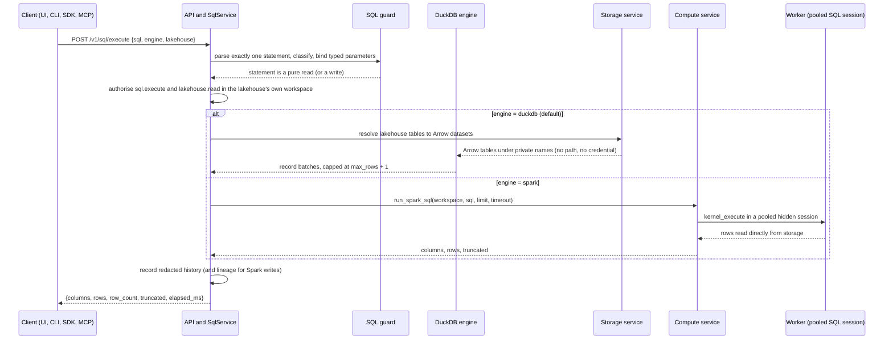
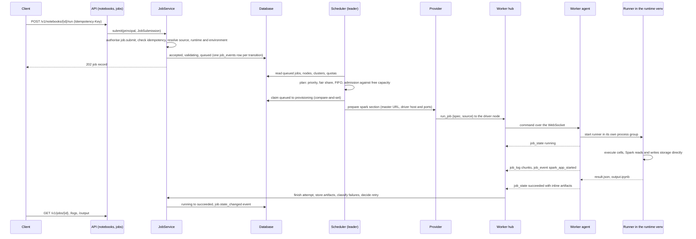
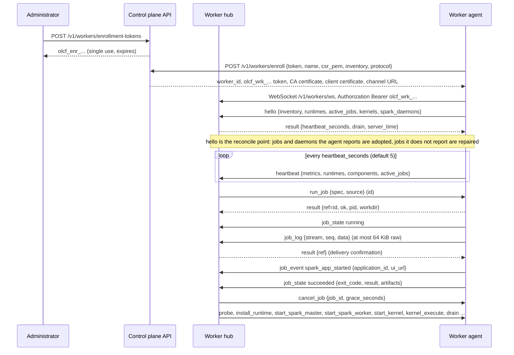
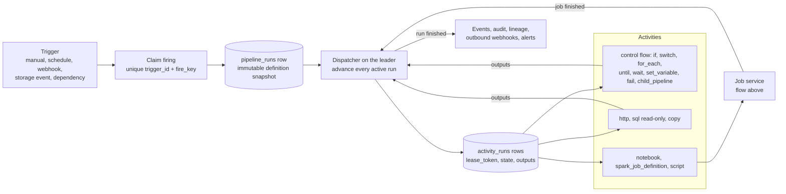
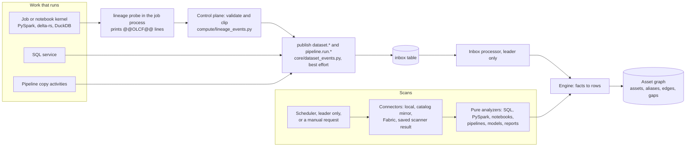

# Components and data flow

This page follows requests through the system. All diagrams were written against the code named next to them; where a behaviour has a limit, the limit is stated.

## Who touches the data

There are exactly two kinds of data access, and the second never goes through the control-plane API.

| Path | Who reads or writes | How | Bounds |
|---|---|---|---|
| Control-plane reads | the SQL service (DuckDB engine), table previews, the catalog, dashboards, MCP tools | delta-rs, PyIceberg or Arrow readers inside the control plane; DuckDB receives Arrow objects registered under private names and has external access disabled | a preview or query returns at most the configured number of rows (`storage.max_preview_rows`, SQL `max_rows`); uploads and downloads are capped (`storage.max_upload_mb`) |
| Compute reads and writes | Spark drivers and executors, Python kernels and jobs on worker nodes | directly from the worker to the store (local path, `s3://`, `abfss://`, OneLake) | none imposed by OLCF |

Credentials for the second path are resolved **at launch time** from the connection's secret by the storage service (`job_storage_conf`), written to a 0600 file next to the job spec on the worker, passed to Spark and to Python clients as configuration or environment variables, and removed when the job ends. They are never returned by an API, logged, audited or stored in a job record. Bulk data is not routed through the control plane unless a user explicitly uploads or downloads a file.

## A SQL query

The DuckDB engine is read-only and hardened twice: the guard rejects anything that is not a pure read, and the connection is locked (external access disabled, configuration frozen). Writes (`INSERT`, `MERGE`, DDL) need the Spark engine and the `sql.write` and `lakehouse.write` permissions. Source: `olcf/sql/service.py`, `guard.py`, `engines.py`.

## A notebook or job run

Every transition is a compare-and-set `UPDATE ... WHERE state = <expected>` written together with a `job_events` row, so any API node can handle an agent callback and a new leader can pick up where the old one stopped. The state machine, retry rules and failure categories are in the [compute model](compute-model.md#job-lifecycle).

## Worker protocol

The channel is a WebSocket the agent opens to `GET /v1/workers/ws` (wire protocol version `1.0`). The controller never trusts the agent's claims about who it is: the worker id comes from the authenticated token, and, when `tls.require_client_cert_for_workers` is on, from the certificate common name too.

Properties that matter in practice:

* **Reconnect.** The agent reconnects with exponential backoff (1 s up to 30 s) forever and re-sends `hello` with its full state every time.
* **Idempotent commands.** `run_job` is keyed by `(job_id, attempt)`; the agent remembers the last 256 command ids and answers a retransmission from its cache. A job is never run twice by a reconnect.
* **Acknowledgements.** Every agent frame that carries an `id` is answered by `result{ref}` or `error{ref}`; log chunks and the terminal state are re-sent until confirmed.
* **Limits.** Agent to controller frames up to 8 MiB, controller to agent up to 24 MiB. Log chunks are streamed to disk on the controller, never held in memory.
* **Close codes.** 4400 protocol violation, 4401 unauthenticated or revoked, 4403 forbidden (certificate mismatch), 4408 timeout, 4409 replaced by a newer connection of the same worker.
* **Multiple control-plane nodes.** A worker connected to another node is reached through the `worker_commands` outbox table, so the leader can schedule onto any worker.

The command set (`ping`, `run_job`, `cancel_job`, `start_spark_master`, `stop_spark_master`, `start_spark_worker`, `stop_spark_worker`, `start_kernel`, `kernel_execute`, `kernel_interrupt`, `kernel_restart`, `kernel_shutdown`, `kernel_complete`, `probe`, `install_runtime`, `drain`, `collect_diagnostics`, `fetch_artifact`, `shutdown`) is defined in `olcf/compute/protocol.py`; the normative text is the "Controller and worker protocol" part of `docs/dev/CONTRACTS.md` (section 4.2 and the node addenda).

## A notebook session (interactive)

A browser (or any client) creates a session with `POST /v1/sessions`; the controller picks a node and sends `start_kernel`. The kernel is an ipykernel with the OLCF bootstrap, a child of the agent on that node. The browser opens `GET /v1/sessions/{id}/ws` and sends `execute`, `interrupt`, `restart` and `complete` messages; outputs come back as `output`, `reply`, `status` and `spark` messages. Everything is also persisted in `session_events`, so any control-plane node can relay it and a reconnecting browser gets `status` plus a replay of the last 500 outputs. Idle sessions are culled after `compute.session_idle_timeout_seconds` (3600); one user may hold at most `compute.max_sessions_per_user` (5).

## A Fabric submission

The sequence is in the [Fabric extension model](fabric-extension-model.md#the-call-flow). In short: the Fabric notebook's SDK obtains a single-use nonce and key, builds and signs the capsule, and submits it by HTTPS; the control plane verifies, analyzes, resolves the data plane and then submits an ordinary job (`kind=capsule`, `origin=fabric`) that goes through the flow above.

## A pipeline run

The database is the state of a run. The dispatcher (leader only) creates an `activity_runs` row only when an activity's dependencies are terminal; each attempt is claimed with a random lease token and every write that ends an attempt is conditional on that token, so a deposed leader cannot overwrite its successor. After a crash, asynchronous activities (a job, a child run, a wait) resume from their persisted state; blocking activities are repeated only if they are declared safe to repeat (copy, read-only SQL, HTTP GET, or `policy.idempotent`); everything else is failed with code `interrupted` and never silently executed twice. A trigger firing first claims `(trigger_id, fire_key)` with a unique insert, so two replicas cannot fire the same schedule twice. More: [pipelines guide](../guides/pipelines.md).

## What ran, and what the platform knows about it (Intelligence)

Two flows feed the asset graph. Neither is on the path of the work itself.

* **Run-time events.** The job process (or the SQL service, or a pipeline) reports which datasets it read and wrote; the control plane validates the report as untrusted input, publishes an ordinary platform event inside a block that swallows any exception, and a durable `inbox` row keeps it until the leader's processor translates it into facts. This is why a verified edge can appear a few seconds after the run, and why an event can be missing without any job having failed.
* **Scans.** A scan reads a source (this installation's database and storage, a Fabric tenant, a saved Power BI scanner result), reads the stored *definitions* (notebook code, SQL, pipeline JSON, model and report definitions) and hands them to analyzers that only read text. The engine turns the resulting facts into rows, one fact per serialised transaction. Only one scan runs per source at a time, across all replicas.
* Both flows write through the same engine, so a run-time observation and a parsed definition meet on the same edge, and the edge keeps the strongest confidence either gave it.

Details, limits and the failure-isolation rules: [OLCF Intelligence](intelligence.md#data-flow).

## Events, logs and metrics

* **Events.** State changes are written to the `events` table with a sequence number. Clients read them with `GET /v1/events` or the SSE stream `/v1/events/stream`; outbound webhooks and alerts are fed from the same table. The catalogue of event types is generated into the [events reference](../reference/events.md).
* **Logs.** Job logs are files below `<data_dir>/jobs/<job_id>/logs/` with an index row per chunk, streamed through `GET /v1/jobs/{id}/logs` with an offset, never loaded whole.
* **Metrics.** The leader samples gauges into a time series table; `GET /v1/metrics` serves Prometheus text format (permission `platform.admin`) and OTLP/HTTP export of metrics and traces can be enabled ([observability](../guides/observability.md)).
