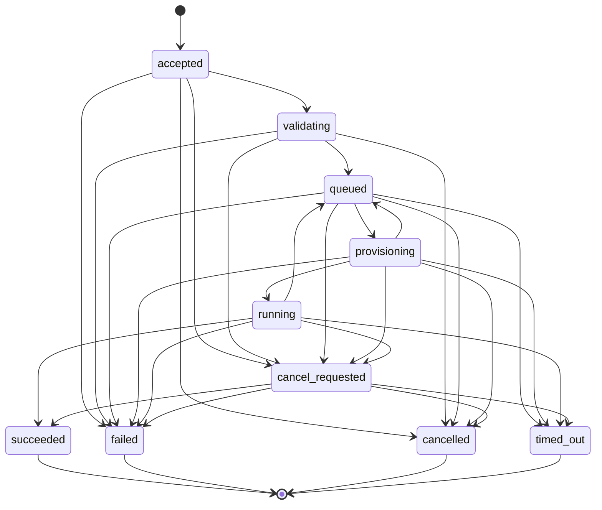

# Compute model

This page describes how machines, Spark clusters, runtimes and jobs relate to each other: what is scheduled, where, and what happens when something fails. Source: `olcf/compute/`, `olcf/worker/`, `olcf/runtime/`, `olcf/core/states.py`.

## Machines: workers, pools and labels

Every machine that contributes compute runs a worker agent ([architecture](architecture.md#worker-agents)). The control plane keeps one `workers` row per agent.

* **Worker state**: `pending` (enrolled, never connected), `online`, `degraded` (missed heartbeats or a failed component check), `offline` (no heartbeat for `compute.worker_offline_after_seconds`, default 20 s, or disconnected) and `revoked` (its certificate serial is on the revocation list, its connection is closed with code 4401 and it cannot re-enrol under the same name).
* **Scheduling state**, independent of health: `active`, `cordoned` (no new allocations) and `draining` (cordoned and waiting for running work to finish). Draining never kills running work.
* **Inventory** reported by the agent: cores, memory, disk, operating system and architecture, hostname and addresses, Python and Java, GPUs if any, installed runtimes (including the built-in host-Python runtime) and agent version. An agent started with `--max-cores` or `--max-memory-mb` advertises a smaller capacity, and the planner uses the smaller of the inventory and the capacity.
* **Pools and labels.** A worker belongs to one pool (`default` unless set) and carries labels (`site`, `rack`, `gpu`, `zone` and anything else). A job can ask for a pool, a set of labels that must all match, or one node. A pool can be *reserved* for chosen workspaces.
* **Reservation.** Every node keeps headroom for the operating system and the agent: `compute.reserve_cores` (default 1 core) and `compute.reserve_memory_fraction` (default 0.15), plus `compute.driver_reserve_fraction` (default 0.25 of the usable resources) that Spark workers leave free for drivers and kernels. The scheduler subtracts running allocations and live memory pressure from what is left, so it cannot oversubscribe a node.

The Compute page and `GET /v1/compute/topology` show all of this live, with one lamp per component (agent, control-plane link, disk, clock, runtime, Spark worker). `POST /v1/workers/{id}/test` runs a probe suite from the node's point of view (DNS and TCP to the control plane, TCP to each Spark master, reachability of each registered storage connection, disk space, clock skew, runtime verification).

## Runtimes

A **runtime** is an immutable, signed, versioned bundle: a Python virtual environment with PySpark and every package pinned by hash, the Maven jars (Delta, Iceberg, the S3 and Azure connectors) pinned by checksum, the Spark configuration defaults and an allow-list of Spark settings a job may change.

| Id | Family | Spark | Delta | Iceberg | Java | Scala | Python |
|---|---|---|---|---|---|---|---|
| `olcf-rt-2.0.0` | `fabric-2.0-compatible` | 4.1.1 | 4.2.0 | 1.11.0 | 17 or 21 (21 default) | 2.13 | 3.13 |
| `olcf-rt-1.3.0` | `fabric-1.3-compatible` (legacy) | 3.5.5 | 3.2.0 | 1.11.0 | 8, 11 or 17 (11 default) | 2.12 | 3.11 |
| `olcf-rt-native-1.0.0` | `olcf-native` | 4.1.1 | 4.2.0 | 1.11.0 | 17 or 21 (21 default) | 2.13 | 3.13 |

The labels read "Fabric Runtime 2.0 **Compatible**": the family aligns the open-source versions with what Fabric documents for its Runtime 2.0 and 1.3 plus OLCF's compatibility packages; it is not Microsoft's runtime and claims no parity with Fabric's proprietary optimisations. The three manifests are in `olcf/runtime/manifests/`.

Besides these bundles every worker offers one built-in pseudo-runtime, [`olcf-host-python`](#the-host-python-runtime-no-spark), which is not a bundle and not in this table.

* **Side by side.** Runtimes install into `<state>/runtimes/<id>/` next to each other; a worker can host several. The scheduler places a job only on a node where its runtime is `ready`, and Spark clusters are never shared between runtimes.
* **Transactional install.** `install`, `repair`, `retire` and `rollback` build in a staging directory and move into place with an atomic rename after verification (a Spark smoke test); a failed install leaves nothing behind. `fingerprint = sha256(manifest + lock)` and is recorded in every job.
* **Signed.** Each manifest carries an Ed25519 signature checked against a trust store; an unsigned, untrusted or modified manifest is refused. **The bundled development key's private half ships with the source** (`olcf/runtime/keys/README.md`), so for production you must generate your own key (`python -m olcf.runtime keygen`), re-sign the manifests and point `OLCF_RUNTIME_TRUST_DIR` at a directory holding only your public key; the development key is then no longer trusted.
* **Never "latest".** pip artifacts are installed with `--require-hashes`; Maven artifacts are checked against their published checksum, recorded in `lock.json` and re-verified every time the runtime starts.
* **Offline.** `python -m olcf.runtime export` writes a tar.gz with the signed manifest, the hash-verified wheelhouse and the jars; `import` installs it with `pip --no-index` and re-verifies every checksum. The control plane can also hold uploaded bundles (`POST /v1/runtimes/bundles`) that workers download with their worker token.
* **Java.** A runtime needs a JDK of a supported major version. With `--with-jdk` a SHA-256-verified Temurin JDK is downloaded into `<runtimes>/_jdk` when none is found ([macOS note](../getting-started/install-macos-no-clt.md)).
* **Per-job dependency layers.** An Environment item pins extra Python packages (hash-locked) and jars on top of the runtime. The worker builds the layer once per node and dependency hash (`pip install --require-hashes --no-deps --target`) and puts it in front of the runtime's site-packages. Limit: a layer exists only on the node that built it, so its Python packages are importable in the driver and in Python workers on that node, but not in executors on other nodes; jars are shipped by Spark. Put such dependencies in the runtime, or use a node-local mirror on every node.

### The host-Python runtime (no Spark)

A Spark runtime is a download of several hundred MB (PySpark, jars from Maven Central, a JDK) and the step of a first run most likely to fail: offline machine, proxy, a Mac without developer tools. Python notebooks do not need any of it, so every worker agent also offers the worker's **own Python interpreter** as a runtime:

| | |
|---|---|
| Id, family | `olcf-host-python`, `host-python` (shown as "Host Python (no Spark)" in the console) |
| Engines | `python` only. It has no Spark, no Java and no Scala; `spark` is `null` in the catalog and `olcf runtime list` shows `no Spark` |
| Lifecycle | built in: nothing to download, install, verify, repair, retire or roll back (`POST /v1/runtimes/olcf-host-python/{install,verify,repair,retire,rollback}` answer `409 conflict`). It is `ready` on a node while that interpreter can import `ipykernel`, `jupyter_client` and `nbformat`; otherwise the node reports it `failed` and names the missing module |
| Switch off | per node with `olcf-worker run --no-host-python` (or `host_python = false` in `agent.toml`); fleet-wide fallback with the setting `compute.host_python_fallback` (below) |
| What it contains | whatever is installed next to OLCF in that interpreter: `deltalake`, `duckdb`, `pandas`, `pyarrow`, `numpy`, `ipykernel` and the other base dependencies, and `matplotlib` only if the `plots` extra (or `matplotlib` itself) is installed. Per-job dependency layers and the sandbox command work on top of it unchanged |

**When a job gets it.** The catalog resolves a runtime when a job or session is created, and the host runtime is chosen in exactly these cases:

* the request names it (`runtime_id: olcf-host-python`, or `family: host-python`) for a Python-engine job; or
* *fallback*: all of the following hold. The engine is `python` (notebook `engine`, `--engine python`, a Python session). The setting `compute.host_python_fallback` is on (the default). The request names no exact `runtime_id` and no Spark, Java or Scala version. Some worker that is online, degraded or offline (not pending or revoked) last reported the host runtime `ready`. A `python` version constraint, if there is one, is satisfied by some worker's interpreter. And either no registered runtime satisfies the request (for example nothing matches a family) or the runtime it would pick (by default the newest of `compute.default_family`) is installed on no worker.

Spark work never falls back: `engine = spark` never gets the host runtime, naming `olcf-host-python` for a Spark job is refused with `422 unsupported` ("has no Spark"), and callers that do not know the engine (the preview `POST /v1/runtimes/resolve`, the hidden pooled sessions that run Spark SQL) never use the fallback. Spark settings in a request that ends up on the host runtime are ignored and the job's notes say so.

A fallback is visible in three places: the job event `runtime_fallback` right after `queued` (`requested` is the runtime that was not installed, or `null`; `using`; `reason`), the notes of the runtime selection, and the job's `runtime_id`. Inside a host-Python kernel `spark` is the same lazy object as anywhere, and its first use raises "this runtime has no Spark ... To fix: olcf runtime install ..." (classified as a `compatibility` failure) instead of a bare `ModuleNotFoundError`.

**Fingerprint.** The catalog row carries a static manifest fingerprint, but the fingerprint recorded for a run is the one the placed node reported: `sha256:` of the canonical JSON of the interpreter's schema tag, Python version, implementation, platform and the versions of `duckdb, deltalake, pyarrow, pandas, numpy, polars, matplotlib, nbformat, jupyter_client, ipykernel, psutil` (absent packages are simply not part of it). It is stored in the job (`GET /v1/jobs/{id}?detail=true` shows it as `hashes.runtime_fingerprint`) and in `result.json` under `dependencies` (`runtime_id`, `runtime_fingerprint` and `host_python` with the Python version and package versions), so a result can be tied to the environment that produced it, exactly like a Spark runtime's fingerprint. Two machines with the same Python and library versions have the same fingerprint.

**Re-binding while queued.** The decision is made when the job is created, and again by the scheduler while the job is still `queued`. A queued `engine = python` job is re-bound to the host runtime when `compute.host_python_fallback` is on, some online worker offers `olcf-host-python`, and the runtime it was bound to is installed on no online worker (for example the workers that offer the host Python connected only after the job was submitted, or the only node with the Spark runtime went away). The job gets a `runtime_fallback` event with `rebound: true`, its Spark settings are dropped (and said so in the runtime notes), and the audit log records `job.runtime_rebound`. It never re-binds a job that pinned a runtime (`runtime_id`), asked for Spark, Java or Scala versions, is Spark work, was placed or has left `queued`, and it never re-binds a job whose runtime is still available somewhere. This closes the first-seconds case: a job submitted before the embedded worker has connected is rescued by the next scheduling pass instead of waiting with `no_runtime` for ever.

Limits to know: the set of libraries is that of the worker's interpreter, so nodes can differ; compare fingerprints when results must be reproducible. With `compute.host_python_fallback` switched off, a Python-engine job whose runtime is missing waits like a Spark job (`no_runtime`), although the wait message still suggests the host runtime.

## Providers

A provider turns a placed job into a running application and can report on it. The interface follows the requirements (`discover`, `submit`, `status`, `logs`, `cancel`, `scale`, `ui`, `reconcile`).

| Provider | Where the Spark application runs | Execution model |
|---|---|---|
| `standalone` | a real Spark Standalone cluster across enrolled machines: one master, one Spark worker per eligible node, driver on a node chosen by the scheduler | agent |
| `local` | driver and executors in one process (`local[*]`) on one node | agent |
| `external` | an existing Spark master URL, or a Livy endpoint (`livy_url`) | agent (master) or remote (Livy) |
| `kubernetes` | driver pods and a headless service created through the Kubernetes API, or `spark-submit --deploy-mode cluster` | remote: the control plane talks to the cluster, there is no worker agent |
| `fabric` | Microsoft Fabric's Livy API, authenticated with Entra client credentials or an access token | remote |

With `compute.default_provider = auto` (the default) a Spark job goes to `standalone` when some eligible node can host a master, a worker and a driver within its reservations (at least 2 usable cores and 2048 MB), and to `local` otherwise; the reason appears in the job timeline. An explicit `placement.provider` is never second-guessed. Provider configuration never contains secrets, only `secret_id` references; keys that look like secrets are rejected. Providers are pluggable through the `olcf.compute_providers` entry-point group.

A **Spark Standalone cluster** exists per runtime and pool. When several runtimes want the same node, capacity is split between them; idle workers of other runtimes are shrunk or stopped to make room, but never while they host a running application. The control plane proxies each master's web UI behind authentication (`/v1/spark-ui/...`); Spark UIs are not exposed unauthenticated.

### Remote providers and the result contract

For remote providers (no worker agent) the control plane polls state and logs and cancels by deleting the pod or killing the Livy session. How the *result* of a run reaches the controller is an explicit contract of each provider (`ComputeProvider.result_contract`), not an assumption of the monitor:

| `result_contract` | Providers | Who produces the result |
|---|---|---|
| `runner` | `kubernetes` | the OLCF runner running in the pod |
| `provider` | Livy (`external` with `livy_url`, `fabric`) | the provider itself reports the outcome (state of the Livy statement or batch) and builds the result document; it does not rely on an `@@OLCF@@` line |

**The runner in a pod.** In remote mode (`--workdir`, the Kubernetes default) the runner, after it has written `result.json` atomically, (1) uploads every declared artifact to `POST /v1/jobs/{id}/artifacts/{name}` (three tries), (2) prints exactly one line `@@OLCF@@ {"event": "result", ...}` followed by `runner_finished`, and (3) writes a compact record (at most 3.5 KiB) to `/dev/termination-log`. The event is capped (`limits.result_event_bytes`, 192 KiB by default); a larger document is shortened, carries a `result_ref`, and the complete document is uploaded as the artifact `result.json`. Without the flags the agent runner behaves exactly as before.

**Completion is never guessed.** A terminal application whose result has not arrived is treated as *incomplete*, not as a success. The monitor then looks for the result in the retained output (`find_result`, independent of the log cursor) and in the termination record, keeps trying for `compute.remote_result_grace_seconds` (default 120), and then fails the attempt with `failure.details.code = "result_missing"` (category `provider`). Because the work may have run, `result_missing` is retried only for jobs with `policy.idempotent`. While it waits the job carries a `result_incomplete` event (`code: result_missing`); the failure's remediation tells the operator to read the driver log and check the target before running the job again, because OLCF cannot know whether the work was done.

**Logs are drained before the job finishes.** The monitor ingests up to `compute.remote_log_pages_per_poll` (16) pages of 256 KiB per poll and finishes a job only when the provider reports the end of the output (`eof`), for at most `compute.remote_drain_timeout_seconds` (300). The position (offset and the provider's cursor) is saved after every page, so a controller restart in the middle of a page neither loses nor duplicates it. If the retained output no longer contains the position (the container log rotated or was truncated, or a one-second burst exceeded the read window) the job log gets an explicit gap marker and a `log_gap` event; a gap is reported, never silently skipped. The Kubernetes pod log is retained by the kubelet, so a very chatty job can lose lines before they are read; the `result` event and the termination record are the backstops for the result, not for every log line.

**Pod layout (Kubernetes).** The job input is a Secret `input` mounted read-only at `/opt/olcf/input`; the runner stages it into the writable `emptyDir` `work` at `/opt/olcf/work` (`--workdir`) and removes the staged `job.json` when it ends; `/tmp` is an `emptyDir`. The pod runs as non-root (uid 10001 by default). See the [Kubernetes guide](../operations/kubernetes.md).

**Livy.** A Livy session or batch is named `olcf-<job_id>-a<attempt>`. A request that may have reached Livy but whose response was lost is *never* repeated blindly: the provider raises `submission_uncertain`, and the monitor reconciles by name before deciding. Possible outcomes are `submission_adopted` (the object exists; the job continues with it), `submission_not_created` (the object was absent for the whole quiesce window, provider setting `submission_quiesce_seconds`, default 60; the attempt fails and may be retried) and `submission_unresolved` (still unknown after `submission_reconcile_seconds`, default 900; the attempt fails and is **not** retried automatically; an operator checks the Livy server and retries with `olcf job retry`). `GET` and `DELETE` retry on transport errors; a `POST` retries only when it provably did not leave the machine (connect failures) or on `429`; any `5xx` answer to a `POST`, `503` included (a gateway can answer `503` after Livy committed the create), is `submission_uncertain` and is reconciled, not repeated. A Livy batch takes its class and arguments from `source.main_class` and `source.args`, and the validated `spark_conf` of the job becomes the session or batch `conf`; platform-owned keys are refused (`403 policy_denied`).

## The scheduler

One scheduler loop runs on the leader (`compute.scheduler_interval_seconds`, default 1 s; it also wakes when a job arrives or ends). All decisions are made by pure functions in `olcf/compute/planner.py`, so the same inputs always give the same plan.

* **Order.** Priority (with aging so nothing starves: `compute.aging_interval_seconds`, default one point per minute of waiting), then weighted fair share across workspaces, then first in, first out.
* **Queues.** Named queues with optional limits: paused, maximum concurrency, maximum cores and memory, per-workspace limits, fair-share weights, allowed pools.
* **Constraints.** Pool (and reserved pools), labels, explicit node, runtime `ready` on the node, provider; cordoned, draining and offline nodes are never used.
* **Admission.** A placement is produced only if the driver fits what is still free on the node and, for Standalone, the cluster has the executor cores and memory. Requests the submitter did not size are *flexible*: they are scaled to the machine (about half the usable cores up to 4, a quarter of the memory up to 4 GiB) so a small machine never refuses a job.
* **Starvation protection.** A job blocked on resources for longer than `compute.starvation_seconds` (300) closes its queue to backfilling for jobs ranked behind it.
* **Infeasible requests** (that can never fit the fleet) are failed after `compute.infeasible_grace_seconds` (300) with a reason instead of waiting forever. A queued job always carries a human-readable `wait_reason`, and the job record shows it structured as `queue_reason` (below).

### Why is my job still queued?

Once the scheduler has looked at a queued job, `GET /v1/jobs/{id}` (and the list) carry `queue_reason`: `{code, message, remediation}`; it is `null` when the job is not queued or has not been evaluated yet. `code` is the planner's stable reason, `message` the sentence for this job and `remediation` the generic fix for the code:

| `code` | The job waits because |
|---|---|
| `paused` | its queue is paused |
| `quota` | the queue or workspace is at its concurrency, core or memory limit |
| `no_runtime` | its runtime is not `ready` on any eligible node. The message says which case: not installed anywhere, installed only on workers that are offline, cordoned or draining, an install is running, the last install failed (with its first detail line), or, for the host runtime, no online worker offers it. Each case names the command that fixes it (`olcf runtime install <id>`; Spark runtimes need PyPI and Maven Central) |
| `no_node` | no schedulable worker is online: bring one online (`olcf serve` embeds one unless `--no-embedded-worker`; or enrol a machine) |
| `constraints` | no online node matches the pool, label, node or reserved-pool constraints |
| `resources` | the driver or executors do not fit what is free yet |
| `infeasible` | the request can never fit the fleet; the job is failed after `compute.infeasible_grace_seconds` |
| `held` | the queue is closed to backfilling behind a starving job |
| `backoff` | the job is retrying after a failure and the back-off has not elapsed |

The timeline gets one `queue_reason` event (an `event` row whose `reason` is the sentence and whose data holds `code` and `message`) each time the *code* changes, not on every re-wording, so "why was it queued" is answerable from `olcf job timeline` alone. The CLI prints `waiting: [code] message` and `fix:` in `olcf job status` and `olcf job get`, `olcf ... --wait` prints each new reason once, and the console's job page shows a banner "Waiting in the queue: <Code>" with a "What to do" line ([cluster guide](../guides/cluster-and-control-panel.md#the-job-page-while-a-job-waits)). A job whose runtime is not installed does not install it: `compute.auto_install_runtimes` (default off) is the only automatic install, and never applies to the host runtime.

## Job lifecycle

The state machine is in `olcf/core/states.py`; the diagram is checked against it by `scripts/check_docs.py`.

| State | Meaning |
|---|---|
| `accepted` | schema, authorisation and idempotency validated |
| `validating` | compatibility analysis (for Fabric-origin or Fabric-like sources), policy, dependencies and runtime resolution |
| `queued` | waiting for eligible resources (see `wait_reason`) |
| `provisioning` | placed; the application is being started (Spark daemons, driver) |
| `running` | the runner is executing |
| `succeeded`, `failed`, `cancelled`, `timed_out` | terminal |
| `cancel_requested` | termination under way: SIGTERM to the job's process group, SIGKILL after `compute.cancel_grace_seconds` (default 15) |

`running -> queued` and `provisioning -> queued` exist only for **automatic retry**. Every transition is persisted with a timestamp and reason in `job_events` and published as a `job.state_changed` event.

### Failures and retries

Each failed attempt is classified into one of the failure categories (`compatibility`, `authn`, `authz`, `storage`, `catalog`, `dependency`, `resource`, `spark`, `user-code`, `timeout`, `cancellation`, `provider`, `internal`; also listed in the [error reference](../reference/errors.md)). The classifier combines the runner's own verdict, exit codes, out-of-memory and signal evidence and log rules.

A retry happens only if all of these hold (`olcf/compute/failures.py:retry_decision`):

1. attempts remain (`max_attempts = 1 + policy.retries`, default 1);
2. the category is retryable: `provider`, `resource`, `spark`, `storage`, `catalog` or `internal`; never user code, dependency, policy, authorisation, cancellation or timeout;
3. a job that had reached `running` is retried only if `policy.idempotent` is true (this includes `result_missing` and an uncertain Livy submission that never resolved);
4. after infrastructure loss, an agent has confirmed the old process is gone (its `hello` no longer lists the job, or it reported a terminal state), so two copies can never run.

Backoff is `retry_backoff_seconds * 2^(attempt-1)`, base 30 s, capped at one hour.

### Recovery

* **Worker lost.** A job on an offline worker stays `running` for `compute.worker_lost_grace_seconds` (180 s). If the worker reconnects and lists the job, it continues. Otherwise, or if a fresh `hello` does not list it for `compute.missing_report_grace_seconds` (30 s), the attempt is closed as a `provider` failure and the retry rules apply.
* **Controller restart or leader change.** Jobs stuck in `accepted`, `validating` or `provisioning` longer than `compute.stuck_state_seconds` (300 s) are re-queued or failed with a reason; `running` jobs are reconciled against the next `hello`; remote-provider jobs are re-attached from their stored handle.
* **Embedded worker.** Jobs on the embedded worker do not survive a restart of the control plane (the agent is stopped with it); they are retried by the rules above. External agents adopt their jobs across restarts.
* **Timeouts.** `limits.timeout_seconds` (default `compute.default_job_timeout_seconds`, 6 h) is enforced by the agent, which escalates SIGTERM to SIGKILL and reports `timed_out`; the control plane enforces it as well.

## Spark settings policy

A job may set Spark configuration only within the runtime's `approved_spark_conf` allow-list. Settings the platform owns (`spark.master`, `spark.app.name`, driver host and ports, block manager port, `spark.submit.*`, authentication and crypto settings, `spark.kubernetes.*`, `spark.jars*`, extra class paths and Java options) are rejected with `403 policy_denied`; other keys that are not approved are dropped and the choice is reported in the job's `rejected_conf`. Environment variables with the prefix `OLCF_` are reserved. The compatibility analyzer reports the same classes of settings before a Fabric notebook starts.

## Sessions

An interactive session is a kernel on a worker node (`start_kernel`), created through `POST /v1/sessions` or `POST /v1/notebooks/{id}/session`. States: `starting`, `idle`, `busy`, `dead` (and `stopped`). By default the Spark driver of a session runs in the kernel's node (`compute.session_provider = local`). The control plane also keeps hidden pooled sessions to run Spark SQL for the SQL editor and MCP (`compute.sql_session_idle_timeout_seconds`, 900).

## Test coverage

Covered by tests of the outside world: Kubernetes (a Kubernetes API server and kubelet written for the tests, a `kubectl` stub and a `spark-submit` stub), Livy and Fabric (a Livy test server with the Fabric path shape and an Entra token endpoint). The controller and the production agent and runner are tested together (`tests/compute/test_real_agent.py`) and a distributed Spark job across several agents on one host is exercised by `tests/integration/test_product_e2e.py` and `tests/compute/test_spark_smoke_real.py`; on one host every executor reports `127.0.0.1`, so the application record cannot tell the machines apart, and the tests prove the distribution through each agent's work directory. The host-Python runtime is tested with the real agent and real kernels (`tests/node/test_host_python.py`), its catalog, fallback rules and every queue reason against the controller with a test agent that can report it (`tests/compute/test_first_run_runtimes.py`), and end to end by running `olcf quickstart --no-runtime` in a subprocess on an empty data directory (`tests/integration/test_first_run_no_runtime.py`). The Kubernetes provider's pod layout, the runner's remote mode, log paging and the result contract are tested against the Kubernetes test server, which plays the API server and the kubelet (it mounts Secrets read-only and runs the real runner), and Livy's retry and reconciliation rules against stubbed transports (`tests/compute/test_review_k8s.py`, `tests/compute/test_review_livy.py`, `tests/node/test_runner_remote.py`). A burst of log output inside a single second is re-read for every page, so its cost grows with the square of the burst (bounded by a 64 MiB window and the drain timeout).
