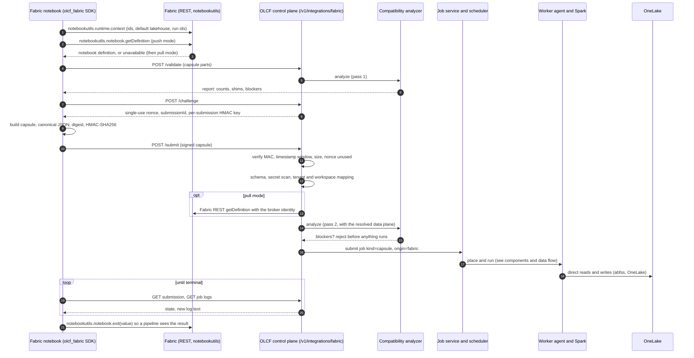

# Fabric extension model

The Fabric extension lets a Microsoft Fabric notebook run **itself** on Spark that you own. One call in the notebook, `olcf.run_remote()`, sends the whole notebook to the OLCF control plane, which checks it, runs it on your compute fabric, and returns status, logs and the exit value to the cell, and, through `notebookutils.notebook.exit`, to a Fabric pipeline. OneLake remains the data plane: your Spark reads and writes it directly.

What it is not: it does not add executors to Fabric's own Spark clusters, it does not run Microsoft's runtime, and it makes no claim of parity with Fabric's proprietary optimisations. The local runtime is labelled **Fabric Runtime 2.0 Compatible**. Microsoft Fabric, Entra and OneLake are not required for anything else in OLCF.

> **Test coverage.** The adapter, the SDK, the analyzer and the shim are exercised end to end in the test suite against a local test server that implements the documented shapes of the Fabric REST API, Entra token endpoints and OneLake. Every assumption about Microsoft's behaviour is listed in [Fabric assumptions](../guides/fabric-assumptions.md); the connection test (`olcf fabric test`, or the Fabric page) checks them against your own tenant.

## The call flow

1. **Context.** The SDK reads `notebookutils.runtime.context`: notebook, workspace and default lakehouse ids and names, run ids, whether the run belongs to a pipeline. Only a fixed list of scalar keys is kept, and anything that looks like a credential is dropped.
2. **Source.** In **push mode** the SDK asks `notebookutils.notebook.getDefinition` for the notebook (trying the `fabricGitSource` format first, then `ipynb`) and sends the text. If that call is unavailable, the SDK falls back to **pull mode**: only identifiers travel, and the control plane fetches the definition itself with the Fabric REST API using a broker identity (an OLCF `onelake` connection whose secret holds an Entra service principal). The cell that calls `run_remote` is excluded from the remote run. `mode="inline"` forbids pull mode; `mode="pull"` forces it.
3. **Validate.** `POST /validate` runs the analyzer and returns the report without submitting anything, so a blocker is found in seconds, before any compute is used.
4. **Challenge and sign.** See below.
5. **Submit.** The control plane verifies, maps the Fabric workspace to an OLCF workspace by the administrator's rules, analyzes again (now knowing where `/lakehouse/default` points), and either rejects with a stable error code or submits a normal job. Each submission is recorded in `fabric_submissions` (also rejected ones), audited and published as an event, so an operator can see why Fabric callers fail.
6. **Wait.** With `wait=True` (default) the SDK streams the remote log into the cell output. On success it hands the exit value to `notebookutils.notebook.exit(...)` so a Fabric pipeline sees it; on any other end state it raises `RemoteExecutionError`, which fails the pipeline activity exactly as a local failure would. With `wait=False` a `RemoteRun` handle is returned and `status`, `logs` and `cancel` work at any time.

Only values the author declared as **parameters** (variables assigned in the cell tagged `parameters`, plus explicit `parameters=`) are sent; nothing else from the interpreter travels.

## The execution capsule

The capsule is the document that is signed and submitted (schema `schemas/capsule-v1.json`, generated from the server models). It carries the schema and SDK versions, a submission id, an idempotency key and timestamps; the source (notebook and workspace ids, format, normalised text, optionally the original definition as Fabric returned it, the cells excluded); the context (normalised and raw); the runtime request (family, constraints, approved Spark settings, an optional dependency lock); the declared parameters; data references (logical lakehouse references, resolved by the control plane); policy (queue, priority, timeout, retries, resources, placement); security claims (tenant, user, app id); and the compatibility summary. Secrets are never part of it: a call such as `getSecret(vault, name)` in the source becomes a reference that the control plane resolves from its own secret store, and a scanner rejects a capsule that contains credential-like values.

### Signing and replay protection

1. The SDK calls `POST /v1/integrations/fabric/challenge` (authenticated). The control plane stores a single-use nonce bound to the caller and to a fresh `submissionId`, derives a per-submission HMAC key from its signing material (rotatable with `POST /v1/integrations/fabric/signing/rotate`), and returns them. The key is never stored; it is re-derived when verifying.
2. The SDK canonicalises the capsule (sorted keys, no whitespace, UTF-8) and computes `digest = sha256(canonical)` and `mac = HMAC-SHA256(key, "olcf.capsule.v1\0" + canonical)`.
3. The control plane re-canonicalises, recomputes both in constant time, checks the timestamp window (`fabric.capsule_max_age_seconds`), the size limit (`fabric.capsule_max_bytes`, 64 MiB, checked before parsing) and that the nonce exists, belongs to the same caller and submission, is unexpired and unused, and marks it used atomically. A retry of the same submission (same id and digest) after a lost response is answered from the existing record.

What this gives you: **integrity** (a capsule altered after signing fails) and **replay protection** (a captured request cannot be submitted twice or later than the window). What it does not give you: **identity**. The key is handed to any authenticated caller, so the signature proves that the body is what the key holder signed, not who the author is. Identity comes from the bearer token and from the tenant and workspace allow-lists. A stolen token can sign anything its principal may submit; revoke it and tighten the allow-lists.

## Identity and authorisation

* **Who may call.** The caller presents either an OLCF personal access token or a Microsoft Entra access token (a Fabric notebook that acquired a token for the OLCF API registration). Entra tokens are validated by the adapter (tenant allow-list, audience and JWKS signature) and mapped to a platform principal `fabric:<tenant>:<object id>` of kind `fabric`. That principal holds the `ServicePrincipal` role **only** in the OLCF workspaces the administrator mapped for its tenant, and its tokens carry the `fabric` scope, which limits it to submitting plus reading and cancelling jobs in those workspaces; `tests/fabric/test_e2e_security.py` checks that it cannot reach anything else. Platform tokens with the `fabric` scope are limited the same way.
* **Where the work lands.** The administrator maps each Fabric workspace id to an OLCF workspace (and optionally a tenant). A submission from an unmapped workspace is rejected.
* **What it may do.** Policy such as `allow_pip_install` and `allow_shell` comes from the administrator's integration configuration; a capsule can only narrow it, never widen it.
* **No broker secret in the notebook.** The control plane's own service-principal secret (the broker identity used for pull mode and for diagnostics) is stored as an OLCF secret referenced by connection id and never leaves the control plane (requirement FA-10). The notebook holds only the caller's credential.

## The compatibility analyzer

The analyzer parses Python with the AST and SQL with sqlglot, keeps cell and line source maps, and classifies every construct it recognises with exactly one rule from a declarative rule file (`olcf/fabric/analyzer/rules/fabric-2.0.yaml`, rule set 1.0.0, **73 rules** in six classes, [catalogue](../reference/fabric-rules.md)):

| Class | Effect |
|---|---|
| `native-portable` | runs unchanged |
| `compatibility-shim` | served by the OLCF `notebookutils` shim or path resolution |
| `deterministic-rewrite` | rewritten by a fixed, listed, source-map-preserving transformation (for example the Fabric-only `VORDER` clause is removed) |
| `warning` | runs, but needs the author's attention |
| `fabric-only-fallback` | a Fabric optimisation with no OLCF equivalent; ignored, results do not change |
| `unsupported` | cannot run: the job is **blocked before execution** with cell, line and remediation |

Ordinary PySpark is not translated; it runs on matching Spark. Anything the analyzer cannot classify, such as an unknown `notebookutils` call or a Spark setting that matches no rule, is reported as unknown and blocks the run (fail closed). Shell escapes, `os.system`, `subprocess(shell=True)` and in-notebook package installs are blocked unless the administrator's policy allows them. The analyzer version and the rewrites applied are recorded with the submission and visible in the job's diagnostics.

The **golden compatibility corpus** (`tests/corpus`) holds ten positive notebook sets (ETL, joins, windows, UDFs, Spark SQL, Delta MERGE, multi-lakehouse, parameters, pipeline invocation, magics) in both notebook formats with expected analyzer reports and expected data, and eleven negative notebooks that must be rejected with specific blockers. The data is compared, not just the job status. Spark-based corpus cases are marked `spark` and need a runtime.

## On the worker

A `capsule` job runs the normalised, possibly rewritten source with the production runner. The runtime-side `notebookutils` (and `mssparkutils`) shim, in `olcf.runtime_lib.notebookutils`, implements a defined subset and **raises a not-supported error with remediation for everything else, never a silent no-op**:

| Namespace | Implemented |
|---|---|
| `runtime.context` | rebuilt from the context the notebook saw in Fabric |
| `fs` | `ls`, `mkdirs`, `cp`, `fastcp`, `mv`, `rm`, `head`, `put`, `append`, `exists` (Hadoop FileSystem, or the local filesystem) |
| `notebook` | `exit`, `run`, `runMultiple` (child jobs through a job-scoped token) |
| `credentials` | `getSecret` (granted secrets only), `getToken` (storage and OneLake audiences) |
| `lakehouse` | `get`, `list` (lakehouses attached to the job) |
| `session` | `stop` |
| `env` | `getWorkspaceName`, `getWorkspaceId`, `getUserName`, `getUserId`, `getJobId` |

Paths are resolved by `olcf.runtime_lib.paths`: `Files/...`, `Tables/...`, `/lakehouse/default/...`, `/lakehouse/<name>/...` and `olcf://workspace/lakehouse/...` map to the job's lakehouse URIs, and `..` escapes are rejected. A Fabric default lakehouse is mapped to an OLCF lakehouse through the workspace mapping (or a `LakehouseMapping` that points at a local copy of the data). The notebook's exit value is returned through the result and, in a notebook run, travels as display data with MIME type `application/vnd.olcf.exit+json`.

## Data plane

For OneLake the worker reads and writes directly with the credentials resolved from the lakehouse's connection at launch (an Entra service principal, a pre-acquired user token, managed identity or the default credential chain; account keys and SAS do not exist for OneLake and are rejected). Data does not pass through the control plane. Delta tables are protected by the [interop policy](workspaces-items-lakehouses.md#lakehouses-and-storage) so that OLCF does not upgrade a table's protocol in a way that would break Fabric's own engines.

## Diagnostics

`POST /v1/integrations/fabric/test` (the *Connection* tab, `olcf fabric test`) runs seven steps and reports each with detail, duration and remediation: DNS, TLS, proxy, Entra token, Fabric API authorisation, OneLake authorisation, and the **inbound path** (tenant and audience allow-lists, JWKS reachability, whether the advertised URL is usable from Fabric, and the age of the last handshake from a real Fabric notebook, which is the only proof that Fabric can reach the control plane). The SDK's `test_connection()` runs the corresponding checks from inside the notebook and reports them as a handshake. Counters, latency and error breakdowns are on the *Metrics* tab and in the Prometheus output (`olcf_fabric_*`).

## Limits to know

* Whole-notebook remote execution is the supported mode. Partial offload of single cells is not implemented.
* The notebook source must be acquirable: either `getDefinition` works in your tenant, or the control plane has a broker identity for pull mode.
* Warehouse semantics are not provided: a Fabric Warehouse is a different engine from Spark over a lakehouse and is out of scope.
* Fabric-specific features without an OLCF equivalent (for example the native execution engine) are ignored or rejected as the rule says; there is no silent substitution.
* Performance relative to Fabric is not claimed.
