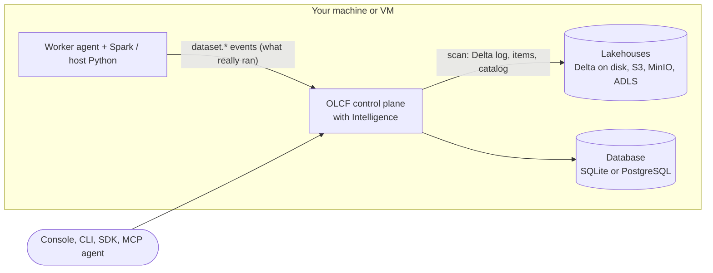
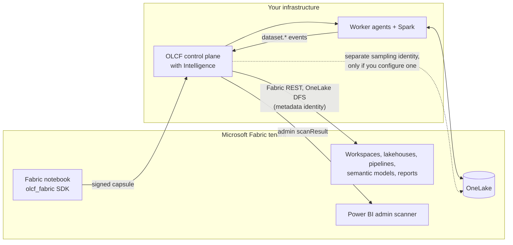
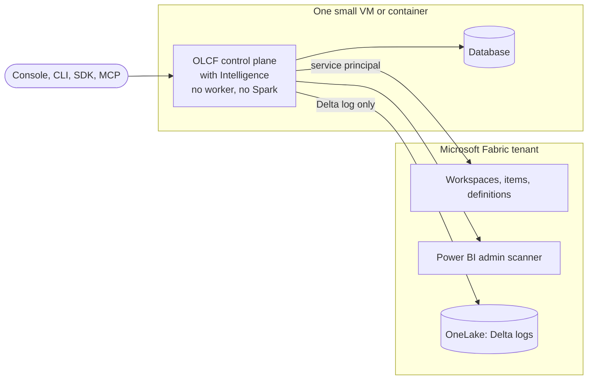

# Intelligence on-premises, with Fabric, and against Fabric only

Author: Justin Dodrill. This page explains the three ways OLCF Intelligence can be deployed and what you get, and do not get, in each. The idea of the module is in [OLCF Intelligence](intelligence.md); the Fabric compute extension is in [Fabric extension model](fabric-extension-model.md).

The module has no hard dependency on OLCF compute and none on Microsoft Fabric. Which of the two you have decides *what it can see*, not whether it works.

| Shape | OLCF compute and storage | Fabric / Power BI tenant | Intelligence sees | Verified lineage |
|---|---|---|---|---|
| **A. On-premises or a VM only** | yes | none | everything in this installation | yes, from OLCF jobs, SQL and pipelines |
| **B. On-premises plus Fabric** (OLCF extends Fabric) | yes, and Fabric notebooks run on it | yes | this installation and the tenant, in one graph | yes, for work that runs on OLCF; not for work that runs inside Fabric |
| **C. Fabric only** | the control-plane process only; no workers, no Spark | yes | the tenant | no |

In every shape one OLCF server process (the control plane) hosts Intelligence, with its database (SQLite or PostgreSQL). "Without OLCF compute" means no worker agent and no Spark runtime, not no server.

## A. On-premises or a VM only

What you get:

* Table and column lineage across notebooks, saved SQL, pipelines, Spark job definitions and dashboards, from static reading of what is stored and from what ran.
* **Verified** edges for work the platform executed, **derived** and **inferred** edges for code that has not run.
* Schema history and a diff between scans, freshness and root-cause analysis from observed writes and run outcomes, an unused-table report, the whole governance layer, and the MCP tools.

What you do not get:

* Anything about systems OLCF does not hold: a web API that a pipeline `http` activity calls appears as an `external` asset named by its URL, with no internals.
* Lineage for work that runs outside OLCF compute (a scheduled job on another machine writing to the same Delta tables is seen as a table that changes, not as a process).
* Run-time evidence for what the probe does not cover (Spark Connect, streaming, JDBC, pandas and polars readers, `DeltaTable.merge`, `update` and `delete` objects). Static analysis still covers some of those.

Status: this shape is what the test suite exercises end to end, on Linux, with SQLite (and a PostgreSQL variant of the graph tests that runs when `OLCF_TEST_POSTGRES_URL` is set).

## B. On-premises plus Fabric (OLCF as external compute, and Intelligence scanning)

Two independent things happen here and Intelligence benefits from both:

1. **OLCF as the compute engine behind Fabric notebooks.** The notebook runs on your Spark; the runner reports which tables and paths it read and wrote; those become verified edges. Tables addressed by OneLake URL are matched to the Fabric lakehouse tables that a Fabric scan found by their normalised location (`onelake_path` / `delta_location` aliases), so one table is one asset.
2. **Intelligence scanning the tenant** with a service principal: workspaces, items, notebook and pipeline definitions, semantic-model and report definitions, lakehouse table schemas (read from the Delta log through OneLake), and the Power BI admin scanner's lineage and data-source information.

What you get: lineage that crosses the boundary (Fabric lakehouse table, to an OLCF-run notebook, to a Fabric semantic model and report), because both sides name the same assets through aliases; governance across both.

What you do not get, and what to be careful of:

* **Work that runs inside Fabric's own engine is not observed.** Fabric Spark, pipelines and dataflows executed by Microsoft produce no `dataset.*` events here. Their lineage is **derived** from their stored definitions and the Power BI scanner result, never verified.
* **A Fabric-submitted run attaches to the assets the tenant scan found, when the identifiers are complete.** The control plane copies the Entra tenant, the Fabric workspace GUID and the notebook's GUID from the job's Fabric origin into the run-time events (`process.fabric`), and the GUIDs of the Fabric lakehouse an OLCF lakehouse is attached to into each dataset (`datasets[].fabric`). The process is then the notebook asset with the same `fabric` alias the tenant scan gave it, and the tables carry the scan's `fabric` and `onelake_path` aliases, so the verified edges land on the same assets in either order (scan first, or events first and the scan promotes the placeholders). With only the notebook's name the process is matched by name inside the OLCF workspace the Fabric workspace maps to and the edges are `inferred`. Not covered: a run whose default lakehouse is not an OLCF lakehouse with a recorded Fabric mapping keeps ordinary table names (no Fabric aliases), and a lakehouse only *mapped* to an on-premises copy keeps its own table assets. This is covered end to end by `tests/intelligence/system/test_fabric_runtime_link.py`.
* **Whether tables really merge across the two sides depends on OneLake URL forms.** Locations are normalised for case and trailing slashes only; the GUID form and the friendly-name form of a OneLake URL are different strings and do not match each other. A mismatch shows up as a placeholder and an `unresolved_reference` gap, not as a wrong merge.
* **The Fabric side follows Microsoft's documentation.** The connector, the scanner import and the OneLake paths are covered by the automated suite through a local test server, and tenant settings differ between organisations, so run the connection test first. See [the guide](../guides/intelligence.md#connecting-microsoft-fabric-and-power-bi), [Fabric assumptions](../guides/fabric-assumptions.md) and [release readiness](../development/release-readiness.md).
* Two identities, on purpose: the **metadata identity** reads metadata; an optional **sampling identity** is the only thing that can read data, and only if a sampling policy allows it. The scanner never reads data with the metadata identity beyond Delta log metadata.
* The platform makes outbound HTTPS calls to Microsoft endpoints (Entra, the Fabric API, the Power BI API, OneLake) from the control plane. See [ports and networking](../reference/ports-and-networking.md#outbound-connections).

## C. Fabric only

You run `olcf serve --no-embedded-worker` (or a container without workers), add a Fabric source, test connectivity, and scan. Nothing else of OLCF is needed.

What you get: an asset catalog of the tenant (workspaces, lakehouses, tables and columns from the Delta log, notebooks, pipelines, semantic models, reports); table and column lineage derived from notebook code, pipeline definitions, SQL, semantic-model definitions (DAX and Power Query M) and report bindings; the scanner's data-source and upstream-dataset relationships; incremental scans; schema history; and the governance layer (glossary, domains, owners, labels with a review queue, certification, policies, quality) on top, with the `intel_*` and `governance_*` MCP tools for an AI agent.

What you do not get:

* **No verified lineage.** Nothing here observes work run by Fabric. Every edge is derived or inferred, and the confidence column says so.
* No freshness or root-cause analysis from observed writes (there are no write events); the Delta log's last-modified time is used when a scan recorded it.
* No sampling of Fabric data unless you configure the separate sampling identity, and then only by the on-demand, masked, audited route.
* No guarantee of coverage: whatever the service principal may not read, or the tenant settings do not expose, is a gap. Typical ones are a workspace it is not a member of, notebook definitions it cannot read, a lakehouse with schemas enabled (the Tables API is not available; the connector falls back to listing OneLake), and Power BI objects the scanner leaves out.
* A first scan of a large tenant is limited by Microsoft's quotas (the scanner API allows 100 workspaces per request and 500 requests per hour; OLCF budgets the hour and waits out `Retry-After` up to `intelligence.fabric_max_wait_seconds`).

## Choosing

| If you... | Use |
|---|---|
| run OLCF for your own data and want to know where things come from | A |
| use Fabric and want a second engine for notebooks, and a map that spans both | B |
| use Fabric (or Power BI) and want catalog, lineage and governance, with no new compute | C |
| want to try the sample first | A: `olcf quickstart`, then [the guide's first look](../guides/intelligence.md#a-first-look-with-the-sample) |

Moving between shapes needs no migration: a Fabric source can be added to an installation that has only local data, and removed again (its assets are marked removed, not deleted).
