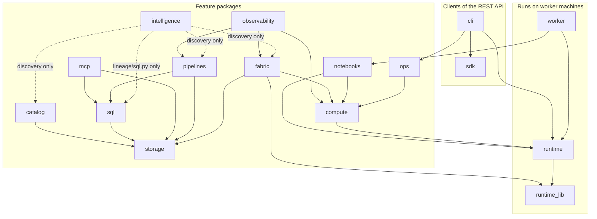

# Repository map

Where things live, and how the parts depend on each other. The runtime architecture is in [Architecture](../concepts/architecture.md); the rules between packages are in [`docs/dev/CONTRACTS.md`](../dev/CONTRACTS.md).

## Top level

| Path | Contents |
|---|---|
| `src/olcf/` | the Python package: server, worker agent, CLI, SDK, runtime manager, web console |
| `sdk/fabric/` | `olcf-fabric`, the standard-library-only package that runs inside a Fabric notebook (separate distribution, `olcf_fabric`) |
| `tests/` | the test suite, one directory per area ([testing](testing.md)) |
| `docs/` | this documentation; `docs/api/openapi.json` is generated; `docs/dev/` holds the engineering contracts, the original requirements and the security-operations notes |
| `schemas/` | JSON Schemas that ship with the package: execution capsule, pipeline document, Fabric import support, sample data |
| `deploy/` | Dockerfiles and Compose, Helm chart, systemd/launchd/Windows service files, Caddy and nginx examples, helper scripts |
| `scripts/` | installers and uninstallers, release build and verification, documentation generators and checks, runtime lock tool, offline bundle builder |
| `examples/` | runnable examples: REST with curl, SDK quickstart, a pipeline, MCP clients, a Fabric notebook cell |
| `.github/` | CI, release, container and security workflows, issue and pull request templates, CODEOWNERS, Dependabot |
| `pyproject.toml` | build metadata (hatchling), dependencies and extras, pytest and ruff configuration |

## The package `src/olcf`

Each feature package follows the same shape: `schema.py` (tables and a migration stream named after the package), a `service.py` or several (the logic, registered on the application context as a named service), `api.py` (FastAPI routers), and `module.py` (`install(ctx)` registers services, health checks and routers). `olcf/api/modules.py` lists the modules in start order.

| Package | Responsibility | Key modules |
|---|---|---|
| `core/` | contracts shared by everything; no heavy dependencies | `config.py` (layered settings), `context.py` (application context, module contract), `errors.py` (exception hierarchy and error envelope), `models.py` (job, resource and policy models), `states.py` (job state machine), `events.py` (persistent event bus), `leader.py` (database-lease leader election), `dataset_events.py` (the `dataset.*` event helpers every publisher shares; knows nothing about Intelligence), `redaction.py`, `ratelimit.py`, `hostbin.py` (finds host tools without running macOS stubs) |
| `db/` | metadata persistence on SQLite or PostgreSQL | `engine.py`, `migrate.py` (versioned migrations in streams), `schema.py` (core tables) |
| `api/` | the FastAPI application | `app.py` (factory), `deps.py` (authentication, ETags, idempotency, pagination), `middleware.py`, `errors.py`, `core/` (identity, workspaces, items, connections, secrets, audit, events, admin) |
| `security/` | identity, authorisation, secrets, audit, PKI | `rbac.py` (roles and permissions), `tokens.py`, `passwords.py` (scrypt), `secrets.py` (AES-GCM store, Vault provider), `audit.py` (hash chain), `pki.py` (built-in CA), `federation*.py` and `ldap_bridge.py` (OIDC, Entra, LDAP) |
| `storage/` | lakehouses and table formats | `providers/` (local, S3, ADLS Gen2, OneLake; plug-ins), `service.py` (the single entry point), `tables.py` (Delta, Parquet), `iceberg.py`, `delta_policy.py` (Fabric interoperability guard) |
| `catalog/` | discovered tables, search, statistics, lineage | `service.py`, `lineage.py` (sqlglot) |
| `intelligence/` | OLCF Intelligence: the asset graph (stable `ast_` identity, lineage with confidence and evidence, impact, staleness, gaps) fed by discovery scans and run-time events; optional and failure-isolated ([contract](../dev/INTELLIGENCE.md), [concepts](../concepts/intelligence.md)) | core: `model.py` (shared vocabulary), `schema.py` (8 tables: assets, aliases, versions, edges, scans, gaps, inbox, analysis cache), `registry.py` (resolve, ensure and merge by alias), `graph.py` (edge upsert, traversal, sweep, diff), `engine.py` (scans and fact application), `queries.py` (lineage, origin, impact, staleness, unused, documentation), `service.py` (facade with the visibility rules), `ingest.py` (event inbox and processor), `runtime.py` (run-time events to facts), `settings.py` (runtime settings), `api.py`, `module.py`. `lineage/` (pure analyzers: `sql.py`, `pyspark.py` with `pyvalues.py`, `notebook.py`, `pipeline_olcf.py`, `pipeline_fabric.py`, `pipeline_common.py`, `spark_job.py`, `report_olcf.py`, `report_pbi.py`, `semantic_model.py` with `tmdl.py`, `dax.py` and `mcode.py`, `scanner.py`, `relation.py`, `base.py`, `engine.py`). `discovery/` (connectors and scans: `local.py`, `catalog_mirror.py`, `fabric.py`, `scanner_import.py`, `base.py`, `scans.py` (runner), `scheduler.py`, `sources.py` and `identities.py` (source storage, secrets), `sampling.py`, `profiling.py`, `detect.py` (sensitive-data suggestions), `service.py`, `api.py`, `schema.py` (2 tables)) |
| `intelligence/governance/` | Governance on top of the Intelligence graph, **observe only** (nothing in the compute, SQL or pipeline path calls it): business glossary, domains and data products, owners and stewards, classification with review queue and lineage propagation, certification and change requests, policies and violations, explainable quality scores ([REST contract](../dev/GOVERNANCE_API.md)) | `schema.py` (14 `gov_*` tables, migration stream `governance`), `models.py` (request and response models), `common.py` (shared helpers and the `Base` manager), `glossary.py`, `domains.py` (domains and data products), `ownership.py`, `classification.py` (catalog, suggestions, review queue, exposure), `flow.py` and `propagation.py` (computed, cached lineage propagation), `workflow.py` (certification and change requests), `selectors.py` and `policies.py` (seven rule types, idempotent violations), `quality.py`, `hooks.py` (registry merge hook), `service.py` (facade, the hooks the core calls, background signals), `api.py` (`/v1/governance/*`), `__init__.py` (`install`, runtime `governance.*` settings, health) |
| `sql/` | SQL over lakehouses | `engines.py` (DuckDB, Spark delegation), `guard.py` (read-only enforcement, parameters), `reports.py` (dashboards), `export.py`, `history.py` |
| `compute/` | the controller side of the compute fabric | `hub.py` (worker WebSocket), `scheduler.py` and `planner.py` (placement), `jobs.py`, `sessions.py`, `runtimes.py`, `providers/` (standalone, local, external, kubernetes, fabric/Livy), `topology.py`, `spark_ui.py`, `failures.py` (classification and retry rule), `lineage_events.py` (validation of the dataset events a runner reports) |
| `worker/` | the agent that runs on every machine | `agent.py`, `jobs.py` (supervision), `kernels.py`, `daemons.py` (Spark master and worker JVMs), `identity.py` (enrollment), `inventory.py`, `sandbox.py` |
| `runtime/` | runtime manifests and the node-side manager | `manager.py` (install, verify, repair, retire, rollback), `manifest.py`, `signing.py` (Ed25519), `locktool.py`, `maven.py`; `manifests/*.json` and `keys/` |
| `runtime_lib/` | code that runs **inside** a runtime virtual environment, next to Spark | `runner.py`, `bootstrap.py`, `executor.py`, `kernel_host.py`, `spark.py`, `magics.py`, `paths.py`, `lineage_probe.py` (reports which datasets PySpark, delta-rs and DuckDB read and wrote), `notebookutils/` (the Fabric shim) |
| `notebooks/` | notebooks, environments, Spark job definitions, variable sets, Git sync | `service.py`, `formats.py` (ipynb, py, Fabric Git format), `environments.py`, `piplock.py`, `gitsync.py`, `promotion.py`, `workspace_io.py` |
| `pipelines/` | orchestration | `engine.py` (durable engine), `expressions.py`, `model.py`, `triggers.py`, `webhooks.py`, `ssrf.py`, `fabric_import.py`, `activities/` |
| `observability/` | metrics, alerts, tracing | `metrics.py`, `collectors.py`, `alerts.py`, `otel.py`, `correlation.py` |
| `fabric/` | the Microsoft Fabric adapter | `service.py`, `capsule.py`, `signing.py`, `auth.py`, `entra.py`, `rest.py` (pull mode), `diagnostics.py`, `analyzer/` and its `rules/fabric-2.0.yaml` |
| `mcp/` | the Model Context Protocol endpoint | `http.py`, `service.py`, `tools.py`, `intel_tools.py` (the 10 `intel_*` tools), `gov_tools.py` (the 4 `governance_*` tools), `resources.py`, `stdio.py` |
| `ops/` | backup, updates, diagnostics, retention, TLS helpers | `backup_core.py`, `crypto.py`, `updates.py`, `manifest.py`, `diagnostics.py`, `support_bundle.py`, `retention.py`, `tlsconfig.py` |
| `sample/` | the Sample Retail workspace | `generate.py`, `installer.py`, `notebooks.py`, `reports.py`, `spec.py`, `intelligence.py` (what the sample shows in Intelligence: scans, glossary, domain, data product, a PII label, certifications), `powerbi.py` (a synthetic Power BI scanner result, labelled as invented) |
| `cli/` | the `olcf` command | `main.py`, `commands/*.py` (grouped by area; `commands/intelligence.py` and `commands/governance.py` with the renderers `intel_render.py` and `gov_render.py`), `doctor.py`, `service.py`, `upgrade.py` |
| `sdk/` | the Python client | `client.py`, `aio.py`, `_resources*.py` (one method per REST operation; `_resources4.py` is `client.intelligence`, `_resources5.py` is `client.governance`), `contexts.py` |
| `web/static/` | the console | `index.html`, `app.js`, `js/pages/*.js` (the Intelligence pages are `intelligence.js`, `intel_*.js`, loaded on demand), `js/intel/*` (vocabulary, deterministic lineage layout, graph walks and SVG drawing for them, with no DOM so Node can test it), `js/ui/*`, `js/core/*`, `css/`, `vendor/` (see `VENDOR.md`) |

An empty directory `src/olcf/jobs/` exists in the working tree; it contains no files and is not part of the package.

## How the parts depend on each other

The diagram shows the direct `import olcf.<package>` edges found by scanning the source (dashed: edges from the `discovery/` connectors of Intelligence to the classic catalog's tables, the Fabric adapter's token and HTTP code and the pipelines' leader-loop helper, and from the SQL analyzer `lineage/sql.py` to the SQL function allowlist; the `sample` package only looks the service up by name) (module-level and function-level imports) for this page, leaving out the edges that every feature package has to the foundation (`core`, `db`, `security`) and to `api` (for `Authed`, `Ctx` and other dependencies).

What the scan shows, and the rules behind it:

* `core`, `db` and `security` are the foundation: they import nothing from the feature packages (`core.context` builds the database, secret store, audit log and CA). Everything else imports `core`.
* Feature packages reach each other mostly through **services** looked up on the context (`ctx.service("compute")`, `ctx.maybe_service("fabric")`). The few direct imports are those in the diagram (several are inside functions to avoid import cycles). `compute`, `storage` and `catalog` do not import `fabric`; the scheduler uses the adapter only through an optional lookup. No compute-side package imports `intelligence/` (an import-graph test, `tests/intelligence/test_isolation.py`, enforces this for `compute`, `worker`, `runtime_lib`, `sql`, `pipelines`, `catalog`, `storage`, `notebooks` and `fabric`): the platform reaches it through published events, and it looks other services up through `ctx.maybe_service`. It is named outside its package only by the registration lists `api/modules.py` and `db/migrate.py`, the MCP tool modules `mcp/intel_tools.py` and `mcp/gov_tools.py`, and the sample installer. In the other direction `intelligence/` imports `core`, `db`, `security` and `api.deps` in its core, and its `discovery/` connectors additionally import `catalog.schema`, `fabric` (`entra`, `http`, `rest`) and `pipelines/common.py`, while the SQL analyzer imports `sql/spark_functions.py` (see the dashed edges in the diagram).
* `runtime_lib/` runs inside separate virtual environments, next to Spark. It imports only `olcf.core` and the standard library plus what the runtime installs, and must not import server code (`docs/dev/CONTRACTS.md` section 12).
* `worker/` imports `runtime` and, for per-job dependency layers, `olcf.notebooks.layer` (standard library only) and, lazily, `olcf.notebooks.envspec`.
* The CLI is a client of the REST API through the SDK, apart from the local lifecycle commands (`init`, `serve`, `doctor`, `service`, `upgrade`, and `backup`/`restore` on a stopped server).

## Tests, docs and deployment

`tests/<area>` mirrors the packages ([testing](testing.md)). `docs/` is organised as getting-started, concepts, guides, reference, operations, development, adr and compliance; the pages under `docs/reference/` marked as generated are written by the scripts in [setup](setup.md#generated-documentation). `deploy/` and `scripts/` are described in the [deploy README](../../deploy/README.md) and the [release process](release-process.md).
