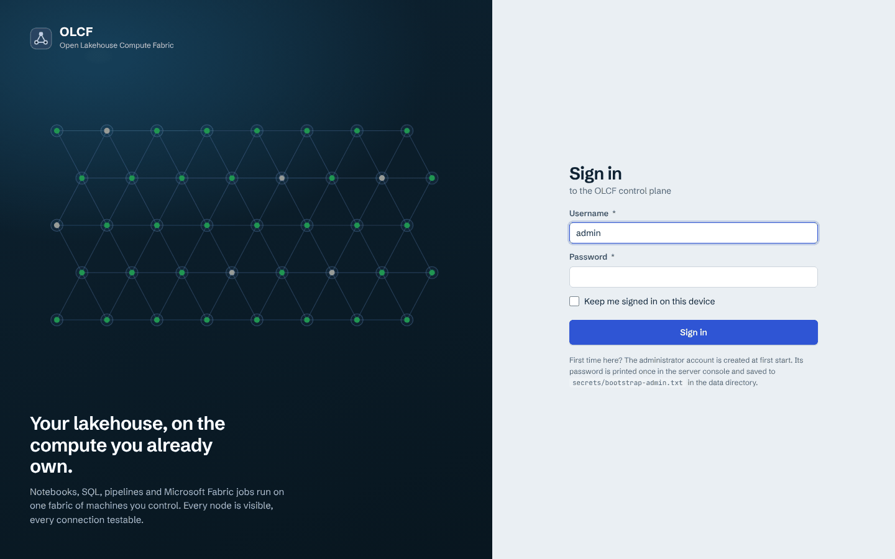
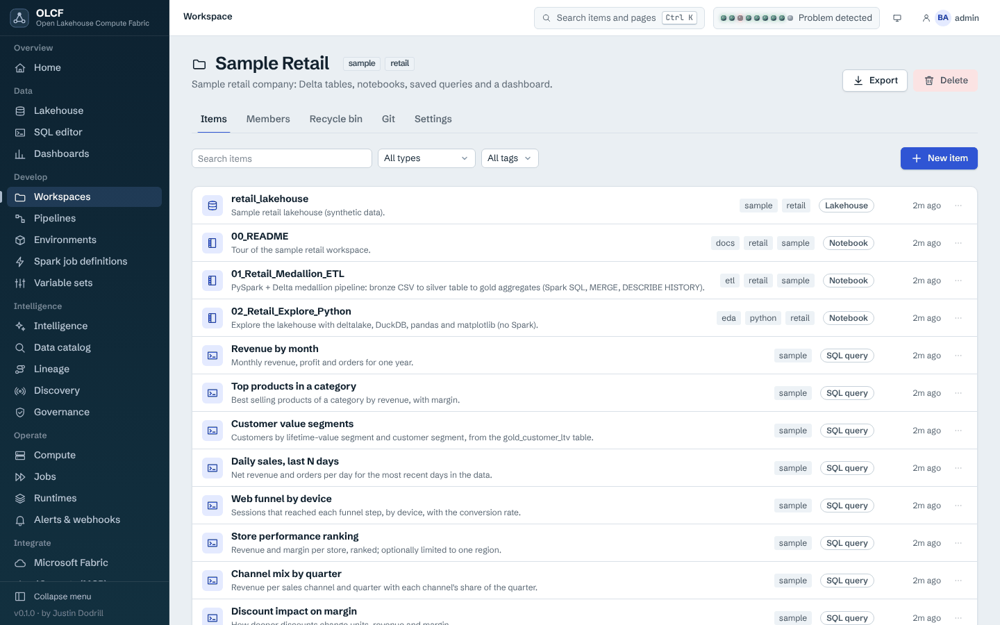
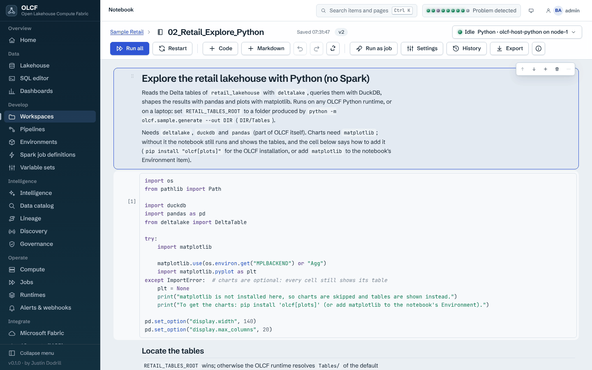
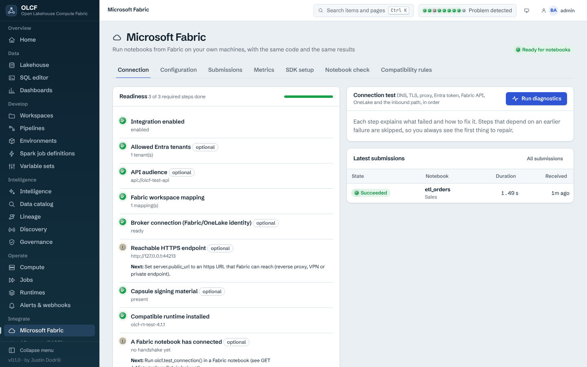

# First-run tour of the console

This is a walk through the web console after `olcf quickstart`, in the order of the navigation rail. The screenshots come from the project's test environment (three worker agents on one host, synthetic retail data, a test Spark runtime); your numbers will differ. More screenshots, including dark theme, are in `docs/images/ui/`.

The console is a single-page application served from the OLCF package itself: no CDN, no external fonts, no telemetry. Open the URL `olcf quickstart` printed (`http://127.0.0.1:8470` unless you chose another port); its "Next steps" also give a direct link to the sample dashboard, `<url>/#/dashboards/<report id>`. Press **Ctrl K** anywhere to search pages and items. The monitor icon in the top bar chooses the colour theme (match system, light or dark); the user menu opens *Security and tokens* and *Change password*. The strip of lamps in the top bar is the platform heartbeat, one lamp per control-plane component; click it for details.

## Sign in

Use `admin` and the password printed by `olcf init` or `olcf quickstart` (also in `<data dir>/secrets/bootstrap-admin.txt`). If your organisation configured single sign-on, the page also offers the identity providers ([SSO and identity](../guides/sso-and-identity.md)). Accounts created by an administrator with `must_change_password` (the box *Require a new password at first sign-in* of the account form, ticked by default in the console; `olcf user create --must-change-password`) can do nothing but change their password on first sign-in: the sign-in page switches to *Choose a new password* and signs you in again with the new one. The server enforces this for every client, including tokens issued before the flag was set; personal access tokens, worker tokens and federated identities are not affected.

## Home

Five tiles (workers online, cores in use, jobs running, failures in 24 hours, Fabric submissions in 24 hours), a "Getting started" checklist that ticks itself (install the sample, connect a compute node, *install a Spark runtime (optional)*, connect Microsoft Fabric, create an access token; the built-in host-Python runtime does not tick the Spark step, because Python notebooks, SQL and dashboards already work without it), the sample-lakehouse card, a *Platform health* panel with every health check grouped into control plane, compute, storage, Fabric, security and agents, and a live *Recent activity* feed. The health checks are listed in the [health check reference](../reference/health-checks.md).

## Data

* **Lakehouse.** Pick a lakehouse and browse `Files` and `Tables`. A table has the tabs *Preview*, *Schema*, *History*, *Details*, *Delta protocol* and *Maintenance*. The protocol tab shows the Delta reader/writer versions and features and what the interop policy says about them; maintenance offers optimise and vacuum, and vacuum defaults to a dry run with safeguards ([SQL and lakehouse guide](../guides/sql-and-lakehouse.md)).
* **SQL editor.** Run SQL against a lakehouse with DuckDB (embedded, no runtime needed) or Spark (needs a runtime). Saved queries are workspace items; history, parameters and CSV/JSON export are built in.
* **Dashboards.** Dashboards are items made of tiles (single number, line, area, bar, donut, table, heatmap, scatter), each backed by a SQL query, with filters. *Retail Sales Overview* comes with the sample.

## Develop

* **Workspaces.** The unit of organisation and access control. A workspace has the tabs *Items*, *Members*, *Recycle bin*, *Git* and *Settings* and can be exported as a ZIP archive. The *Sample Retail* workspace holds a lakehouse, three notebooks (`00_README`, `01_Retail_Medallion_ETL`, `02_Retail_Explore_Python`), nine saved queries and a dashboard.

  

* **Notebooks.** Open `02_Retail_Explore_Python` and use *Run all*. A real Jupyter kernel starts on a worker node, so the session survives a browser refresh; reconnecting replays the last 500 outputs. This notebook uses only `deltalake`, DuckDB and pandas, so it runs on a fresh installation with no Spark runtime, on the worker's own Python (the built-in `olcf-host-python` runtime). Its charts need `matplotlib` (`pip install "olcf[plots]"`); without it every cell still shows its table and the first cell says how to get the charts. `01_Retail_Medallion_ETL` uses Spark: its job waits (see *Jobs* below) until a Spark runtime is installed. Parameters (cells tagged `parameters`), the runtime, the default lakehouse and the environment are set in the notebook settings.

  

  

* **Pipelines.** Design a DAG of activities, run it, and read the run graph (nodes, timings, critical path). Tabs: *Pipelines*, *Runs*, *Schedules*, *Triggers* ([pipelines guide](../guides/pipelines.md)).
* **Environments**, **Spark job definitions**, **Variable sets.** Environments pin a runtime and a hash-locked dependency set; Spark job definitions describe a Python, Scala or Java application (main file or class, arguments, Spark settings); variable sets hold per-stage values and secret references ([notebooks guide](../guides/notebooks.md)).

## Intelligence

Five pages that answer "what data do we have, where does it come from and who is affected when it changes". Everything on them comes from scans of your sources, and every page says plainly what the scans could not see; a page never claims that the lineage is complete.

* **Intelligence.** The overview: how many assets and connections were found, open gaps, how much code could be read, the sources and when each was last scanned, and a quick search. *Scan now* runs a scan and shows its progress and result.
* **Data catalog.** Search and filter every table, column, notebook, query and report by type, workspace, tag and (when governance is installed) domain, label, certification and owner. The filters are kept in the address, so a search can be shared. A result opens the asset page with the tabs *Overview*, *Columns*, *Lineage*, *Impact*, *Origin*, *Quality*, *Documentation*, *History*, *Sample* and *Governance*.
* **Lineage.** A picture of where an asset's data comes from and what uses it: direction, number of steps, table or column level, and how sure OLCF is of each connection (line style: verified, derived, inferred, unknown). Click an asset or a line to see the evidence (which notebook or query, which line). The same information is available as a table and can be exported as JSON or SVG. The page also has an impact view: everything downstream that would be affected, grouped by type, with owners where they are known and what could be holding the answer up.
* **Discovery.** The sources Intelligence learns from (the local installation, the catalog, Microsoft Fabric, an imported Power BI scanner file), with *Test connectivity* that shows each step and what to do when one fails, scans and what each found, gaps (things a scan could not read, each with how to fix it), coverage, changes between two scans and sampling policies. Showing sample rows is off everywhere until an administrator allows it for a scope; the page explains what that means before it is switched on.
* **Governance.** Glossary, domains and data products, sensitivity labels and their review queue, certification and change requests, policies and violations, an exposure explorer and owners. Governance observes and reports: a policy never blocks work. Suggestions made from column names are only guesses until a person approves them.

Write actions (scan, edit a source, approve a suggestion, certify) appear only for people who have the permission; everyone with access can read. The sample workspace is scanned when it is installed, so these pages are filled on the first day; the task-oriented walk-through, with the same questions asked from the CLI, the SDK and an AI agent, is the [Intelligence guide](../guides/intelligence.md#a-first-look-with-the-sample), and the Power BI part of the sample is a synthetic scan labelled as invented.

## Operate

* **Compute.** The fleet at a glance.

  

  Tabs: *Machines* (one card per worker with CPU, memory, disk, core reservation, sparklines and one lamp each for agent, control-plane link, disk, clock, runtime and Spark worker), *Spark clusters*, *Control plane*, *Queues and pools*, *Runtimes*. **Test** on a machine runs a connectivity suite from that machine's point of view; **Spark smoke test** runs a tiny distributed job and reports which machines hosted executors. The runtime badges of a machine include `host-python`, the built-in Python-only runtime. Cordon and drain take a machine out of scheduling. See [the cluster guide](../guides/cluster-and-control-panel.md).
* **Jobs.** Every notebook run, Spark job, SQL job and Fabric submission. A job has *Logs*, *Overview*, *Timeline* (every state transition with its reason, plus events such as `runtime_fallback` and `queue_reason`) and *Output* (artifacts such as the executed notebook). A queued job explains itself in a banner, "Waiting in the queue: No runtime" for instance, with a *What to do* line; a job that runs on the host-Python runtime shows "Running on the host Python runtime" ([details](../guides/cluster-and-control-panel.md#the-job-page-while-a-job-waits)).
* **Runtimes.** *Catalog* (installed runtimes per machine, with install, verify, repair, retire and rollback; the first card on a fresh installation is **Host Python (no Spark)**, marked *Built in* and *No Spark*, with nothing to install), *Compatibility* (matrix of runtime families) and *Offline bundles*.
* **Alerts and webhooks.** Built-in alert rules (failed jobs, queue saturation, worker loss, disk pressure, runtime mismatch and more), notification channels and signed outbound webhooks.

## Integrate

* **Microsoft Fabric.** Tabs *Connection* (readiness checklist and the stepwise connection test), *Configuration*, *Submissions*, *Metrics*, *SDK setup* (the cell to paste into a Fabric notebook), *Notebook check* (paste a notebook, get the compatibility report) and *Compatibility rules*.

  

  Nothing here needs a Microsoft subscription until you configure a tenant; see [Fabric integration](../guides/fabric-integration.md).
* **AI agents (MCP).** Ready-to-paste configuration for Claude Desktop and Claude Code, a "try it" console and the list of tools ([MCP guide](../guides/mcp.md)).
* **Connections and secrets.** Storage accounts, databases, HTTP and Git hosts. Secret values are write-only: they are never returned by any API.

## Administer

* **Security.** *My account*, *Accounts*, *Roles and access*, *API tokens*, *Identity providers*, *Certificates*, *Audit log* (with a "verify the chain" action). Which tabs you see depends on your permissions.
* **Administration.** *Health*, *Settings* (the runtime settings), *Backup and restore*, *Updates*, *Diagnostics* (support bundle), *Data retention*.
* **API reference** opens Swagger UI at `/v1/docs`; **About** shows versions and licences, including the third-party notices.

## Things to try

1. Run `02_Retail_Explore_Python`, then open *Jobs* and find the run (its runtime is `olcf-host-python`). Then run `01_Retail_Medallion_ETL` and watch the waiting banner until you install a Spark runtime.
2. Open *Compute > Machines*, click *Test* on the node, then run the *Spark smoke test* (needs a Spark runtime: `olcf runtime install --with-jdk` first).
3. Create a token under *Security > API tokens* and use it from the CLI: `olcf login --token-stdin`.
4. Open *AI agents*, copy the Claude Code configuration and ask a question about the retail data.
5. Run `olcf audit verify` and look at *Security > Audit log*.
